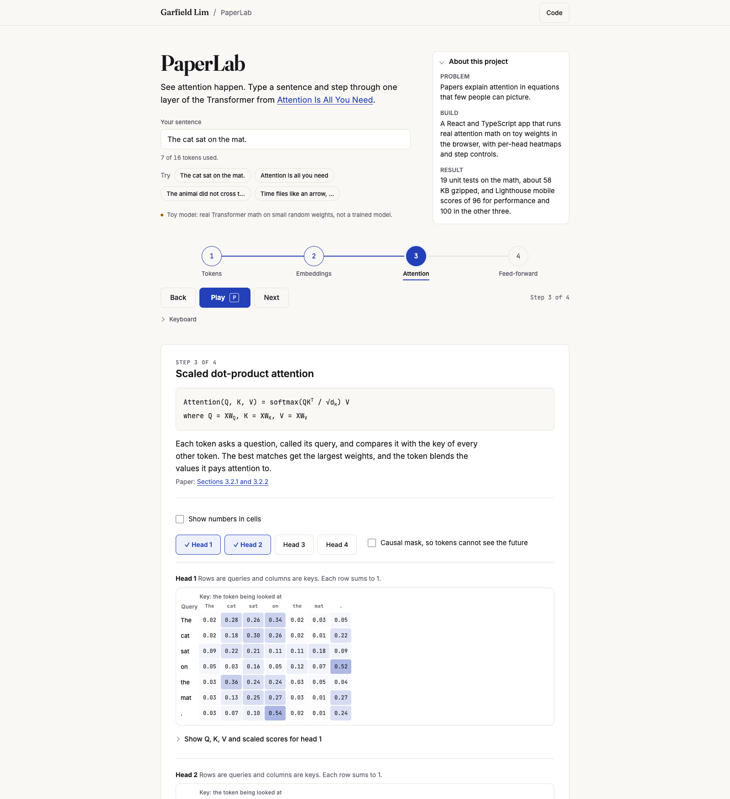
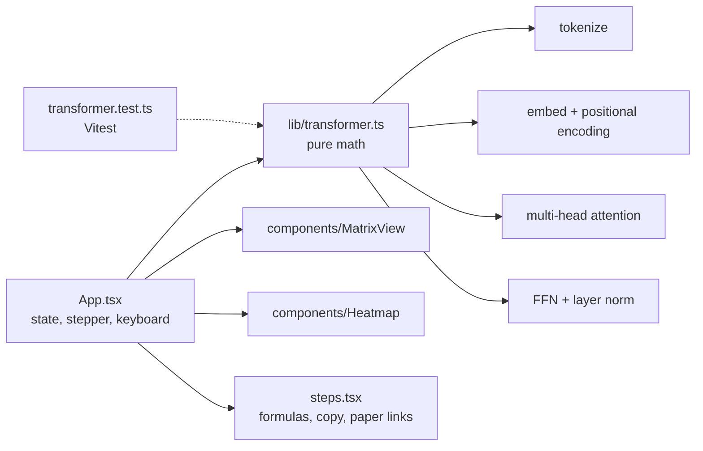

# PaperLab

See attention happen. Type a sentence and step through one layer of the Transformer from "Attention Is All You Need".

*Toy model: real Transformer math on small random weights, not a trained model.*

## In 30 seconds

- **Problem:** Papers explain attention in equations that few people can picture.
- **Build:** A React and TypeScript app that runs real attention math on toy weights in the browser, with per-head heatmaps and step controls.
- **Result:** 19 unit tests on the math, about 58 KB gzipped, and Lighthouse mobile scores of 96 for performance and 100 in the other three.

## Live demo

https://monsieurgregorio2001-coder.github.io/paperlab/ (the GitHub Pages deploy workflow is included but has not run yet).

## Features

Type a sentence (up to 16 tokens) or pick a preset, then step through four stages with Back, Play, Pause and Next, or with the keyboard (left and right arrows step, P plays or pauses, Space activates the focused button).

1. **Tokenization.** A simplified word-level tokenizer (real models use subword BPE). Tokens get ids from a hash.
2. **Embeddings and positional encoding.** `d_model = 16`. Embeddings come from a seeded hash per token. Positional encoding is the sinusoidal formula from section 3.5 of the paper. The sum is shown.
3. **Scaled dot-product attention.** 4 heads with `d_k = 4`. `Q, K, V = XW_Q, XW_K, XW_V` with seeded toy weights, `softmax(QK^T / sqrt(d_k)) V`, a heatmap per head, per-head toggles, click a token to see what it attends to, optional causal mask.
4. **Feed-forward, residual and layer norm.** `FFN(x) = max(0, xW1 + b1)W2 + b2` with `d_ff = 32`, then `LayerNorm(x + FFN(x))`.

Everything is deterministic: the same sentence always gives the same output. There is no backend, no API key and no network call at runtime.

## Architecture

All math lives in `src/lib/transformer.ts` with no DOM or React dependency. Formulas are rendered as styled HTML and Unicode (no KaTeX) to keep the bundle small.

## Tests and measured results

`npm test` runs 19 Vitest tests. They cover softmax rows summing to 1 within 1e-6, attention output shapes, causal masking, positional encoding against the paper formula, layer norm, tokenizer edge cases, and determinism.

Measured on the production build served by `vite preview`:

| Measure | Result |
| --- | --- |
| Initial JS and CSS, gzipped | 53.5 KB JS plus 4.4 KB CSS, about 58 KB |
| Fonts (latin subsets, self-hosted) | about 159 KB woff2: Fraunces 67 KB, Inter 48 KB, JetBrains Mono 43 KB |
| Lighthouse mobile preset | performance 96, accessibility 100, best practices 100, SEO 100 |
| axe-core, light and dark, all four steps, at 360 and 1280 px | 0 violations, including colour contrast |
| Horizontal page scroll at 360 px | none on any step |

Heatmap text colour is chosen in `src/lib/ramp.ts` so every cell stays at WCAG AA contrast in both themes.

## Accessibility

Keyboard operable with visible focus rings, ARIA labels, and cell values exposed through `title` and `aria-label`. Numbers can be shown in every cell, so colour is never the only cue. The current step is marked by shape, weight, and underline as well as colour. Light and dark themes follow `prefers-color-scheme`, and motion is disabled under `prefers-reduced-motion`.

## Credits

Type: Fraunces, Inter, and JetBrains Mono through Fontsource, all under the SIL Open Font License. Inspired by Clement Mihailescu's algorithm visualizers and Two Minute Papers. Not affiliated.

Paper: Vaswani et al., "Attention Is All You Need", https://arxiv.org/abs/1706.03762

## License

MIT, Garfield Greg Lim III, 2026.
