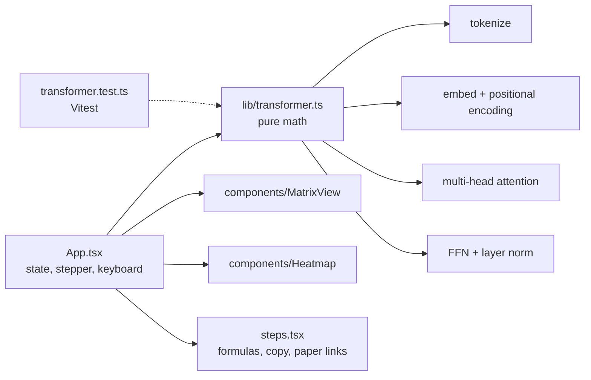

# PaperLab

An interactive visualizer that walks through one layer of the Transformer from "Attention Is All You Need" (Vaswani et al., 2017), using real math on a small toy model.

> Screenshot placeholder: add `docs/screenshot.png` (step 3, attention heatmap) and reference it here after the first deploy.

**Toy model: real Transformer math on small random weights. Not a trained model.**

## How it works

Type a sentence (up to 16 tokens) or pick a preset, then step through four stages with Back, Play, Pause and Next, or with the keyboard (left and right arrows, space).

1. **Tokenization.** A simplified word-level tokenizer (real models use subword BPE). Tokens get ids from a hash.
2. **Embeddings and positional encoding.** `d_model = 16`. Embeddings come from a seeded hash per token. Positional encoding is the sinusoidal formula from section 3.5 of the paper. The sum is shown.
3. **Scaled dot-product attention.** 4 heads with `d_k = 4`. `Q, K, V = XW_Q, XW_K, XW_V` with seeded toy weights, `softmax(QK^T / sqrt(d_k)) V`, a heatmap per head, per-head toggles, click a token to see what it attends to, optional causal mask.
4. **Feed-forward, residual and layer norm.** `FFN(x) = max(0, xW1 + b1)W2 + b2` with `d_ff = 32`, then `LayerNorm(x + FFN(x))`.

Everything is deterministic: the same sentence always gives the same output. There is no backend, no API key and no network call at runtime.

## Architecture



All math lives in `src/lib/transformer.ts` with no DOM or React dependency. Formulas are rendered as styled HTML and Unicode (no KaTeX) to keep the bundle small.

## Run locally

```bash
npm install
npm run dev        # development server
npm test           # unit tests
npm run build      # type check and production build into dist/
npm run preview    # serve the build at http://localhost:4173/paperlab/
```

Works on Node 18 or newer (developed with Node 26). The Vite `base` is `/paperlab/` for GitHub Pages. A deploy workflow is in `.github/workflows/deploy.yml` (not yet run).

## Test results

`npm test`: 19 tests passing in 1 file. They cover softmax rows summing to 1 within 1e-6, attention output shapes, causal masking, positional encoding against the paper formula, layer norm, tokenizer edge cases (empty, punctuation, more than 16 tokens) and determinism.

## Measured

- Initial JS plus CSS, gzipped: 52.1 KB JS + 2.2 KB CSS, about 54 KB total (target under 300 KB).
- Lighthouse (headless Chrome against `vite preview`, desktop defaults of the CLI): performance 100, accessibility 100, best practices 100, SEO 100.
- Checked at 360 px wide: no horizontal page scroll. Heatmaps and matrices scroll inside their own container.

## Accessibility

Keyboard operable, visible focus rings, ARIA labels, heatmap cells expose values through `title` and `aria-label`, numbers are printed in attention cells so color is never the only cue, and light and dark themes follow `prefers-color-scheme`.

## Credits

Inspired by Clement Mihailescu's algorithm visualizers and Two Minute Papers. Not affiliated.

Paper: Vaswani et al., "Attention Is All You Need", https://arxiv.org/abs/1706.03762

MIT License, Garfield Greg Lim III, 2026.
